  
  
  
  

  
   
  <em>Uso real em projetos e estudo — não um atestado de domínio.</em>
   
  Cada número é medido, nunca digitado — atualizado todos os dias por <a href="https://github.com/ReiThomato/ReiThomato/actions/workflows/update-languages.yml">esta automação</a>.

